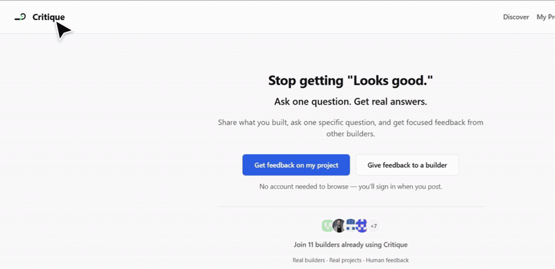
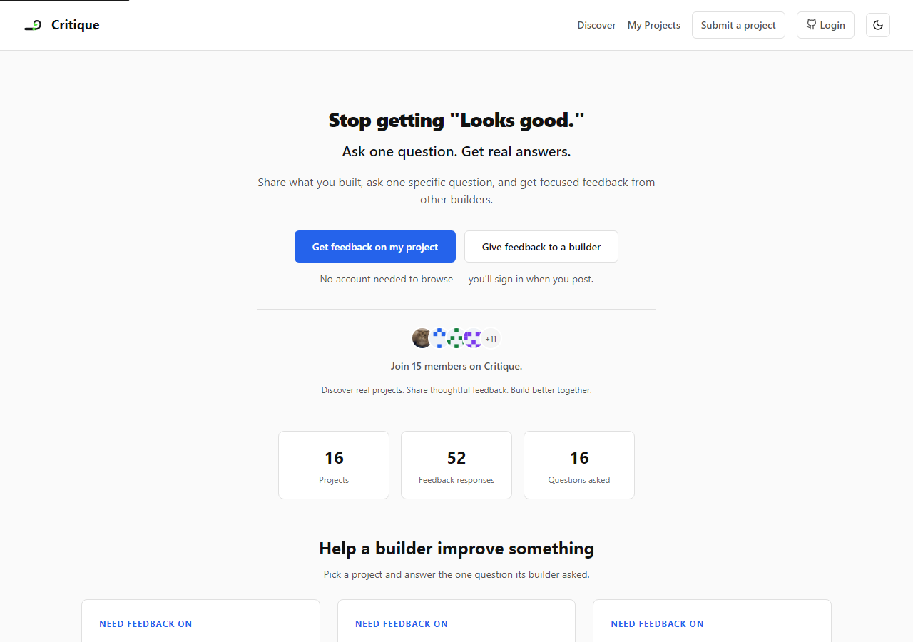
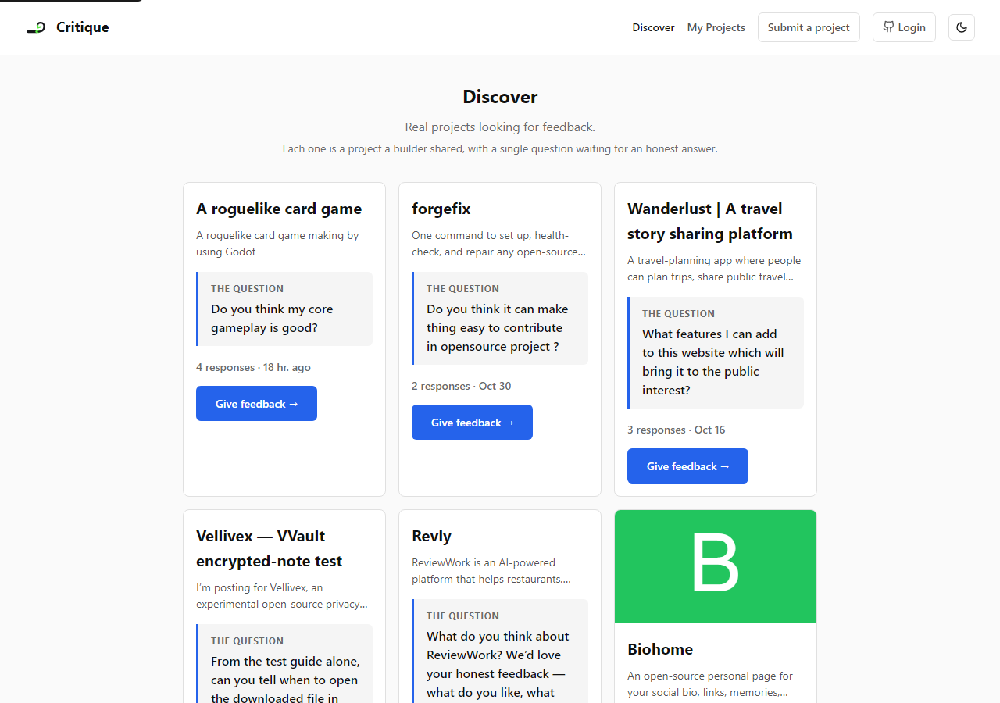

<p align="center">
  
</p>

<h1 align="center">Critique</h1>

<p align="center">
  <strong>Ask one question. Get real answers.</strong>
</p>

<p align="center">
  Critique es una plataforma de código abierto para recibir comentarios humanos
  enfocados y estructurados sobre tus proyectos. Comparte lo que estás construyendo,
  haz una pregunta específica y recoge respuestas de personas reales que ven tu trabajo.
</p>

<p align="center">
  <a href="https://github.com/BistaDinesh03/critique/actions/workflows/tests.yml"></a>
  <a href="https://github.com/BistaDinesh03/critique/actions/workflows/visual-tests.yml"></a>
  <a href="LICENSE"></a>
  <a href="https://github.com/BistaDinesh03/critique/stargazers"></a>
  <a href="https://github.com/BistaDinesh03/critique/network/members"></a>
  <a href="https://github.com/BistaDinesh03/critique/commits/main"></a>
</p>

<p align="center">
  <a href="https://critique.page/">Probar Critique</a> ·
  <a href="https://critique.page/discover">Explorar proyectos</a> ·
  <a href="https://github.com/BistaDinesh03/critique">Código fuente</a> ·
  <a href="https://github.com/BistaDinesh03/critique/issues">Issues</a> ·
  <a href="https://github.com/BistaDinesh03/critique/discussions">Discussions</a> ·
  <a href="CONTRIBUTING.md">Contribuir</a> ·
  <a href="SECURITY.md">Seguridad</a>
</p>

<p align="center">
  <a href="README.md">English</a> ·
  <a href="README.zh-CN.md">简体中文</a> ·
  <a href="README.ja.md">日本語</a> ·
  <strong>Español</strong>
</p>

> Este documento es la traducción al español de Critique. **El [README.md](README.md) en inglés es la versión canónica**;
> si hay discrepancias, prevalece la versión en inglés.

## Contenido

- [Ver Critique en acción](#ver-critique-en-acción)
- [El problema](#el-problema)
- [La solución](#la-solución)
- [Cómo funciona](#cómo-funciona)
- [Funcionalidades](#funcionalidades)
- [Modelo de comentarios](#modelo-de-comentarios)
- [Insignia de comentarios](#insignia-de-comentarios)
- [Probar Critique](#probar-critique)
- [Capturas](#capturas)
- [Tecnologías](#tecnologías)
- [Arquitectura](#arquitectura)
- [Primeros pasos](#primeros-pasos)
- [Variables de entorno](#variables-de-entorno)
- [Base de datos](#base-de-datos)
- [Pruebas](#pruebas)
- [Arquitectura y API](#arquitectura-y-api)
- [Seguridad y privacidad](#seguridad-y-privacidad)
- [Despliegue](#despliegue)
- [Analítica del producto (histórica)](#analítica-del-producto-histórica)
- [Contribuir](#contribuir)
- [Código abierto](#código-abierto)
- [Licencia](#licencia)

## Ver Critique en acción

Un recorrido de 62 segundos por el producto real: la página de inicio, el feed
Discover, una página de proyecto y los resultados de comentarios que recibe un
creador.



¿Quieres el recorrido completo? [Mira el video de 62 segundos.](https://dineshbista.com.np/critique/watch.html)
El GIF de arriba es una vista previa de 12 segundos. El recorrido completo dura
62 segundos sin audio, y el reproductor de la página de visualización solo se
inicia cuando pulsas Play. ¿Prefieres el archivo original? Usa el
[enlace directo al MP4](https://dineshbista.com.np/critique/videos/critique-overview.mp4)
(46.8 MB). Archivo original: [docs/videos/critique-overview.mp4](docs/videos/critique-overview.mp4).

## El problema

Puedes pasar horas construyendo algo y aun así no saber si otra persona entiende
qué es, qué hace o por qué importa. Publicar "¿qué opinas?" suele ganar un
rápido "¡se ve bien!" — amable, pero no accionable.

Los creadores se quedan adivinando: ¿los usuarios entendieron el proyecto?
¿Realmente lo usarían? ¿Qué debería mejorar? Los comentarios vagos no responden
ninguna de esas preguntas.

## La solución

Critique reemplaza la adivinanza por una señal clara. Comparte tu proyecto, haz
**una pregunta enfocada** — por ejemplo, *"¿Se entiende en 10 segundos qué hace
esto?"* — y recibe comentarios estructurados de personas reales.

Una sola pregunta mantiene las respuestas comparables, y cada respuesta es una
señal sobre la que puedes actuar. Todos los comentarios provienen de humanos que
usan el sitio; Critique no contiene respuestas generadas por IA.

> Un proyecto. Una pregunta enfocada. Comentarios humanos reales.

## Cómo funciona

<table>
  <tr>
    <td align="center"><strong>1. Crea un proyecto</strong><br>Añade lo que construiste y lo que hace.</td>
    <td align="center"><strong>2. Haz una pregunta enfocada</strong><br>La única cosa que más quieres saber.</td>
    <td align="center"><strong>3. Compártelo con personas</strong><br>Envía el enlace donde esté tu audiencia.</td>
    <td align="center"><strong>4. Aprende del feedback estructurado</strong><br>Valoraciones para cada respuesta, más sugerencias escritas opcionales.</td>
  </tr>
</table>

## Funcionalidades

- **Discover** — un feed público de proyectos que buscan feedback, ordenado
  de forma determinista (necesidad, frescura, calidad de la pregunta y más)
- **My Projects** — gestiona tus envíos y revisa resultados
- **Panel de resultados** — totales, barras de distribución, feedback escrito y
  exportación CSV para cada proyecto
- **Una pregunta enfocada** — cada proyecto hace una sola pregunta, y dos
  preguntas de valoración fijas hacen que las respuestas sean fáciles de escanear
  y comparar
- **Sugerencias escritas privadas** — adjuntas al proyecto, visibles solo para
  su propietario
- **Compartir simple** — publica en X o Reddit, o copia el enlace, justo después
  de enviar o desde My Projects
- **Volver arriba** — control accesible de scroll al inicio en páginas largas
- **Estilos de impresión** — impresión limpia para las páginas de detalle y
  resultados del proyecto
- **Insignia dinámica** — un SVG con el conteo de respuestas en vivo para tu README
- **Analítica configurable** — lista de permitidos de propietarios del panel de
  analítica mediante `ANALYTICS_OWNER_USERNAMES`
- **Opciones de inicio de sesión** — GitHub OAuth o enlace mágico por correo sin
  contraseña
- **Consciente de la privacidad** — no se almacenan IP sin procesar, sin
  scripts de seguimiento de terceros, datos de analítica mínimos
- **Código abierto** — la implementación completa es pública bajo licencia MIT,
  y la aplicación se ejecuta localmente sin configuración adicional
- **Soporte SEO** — `robots.txt`, `sitemap.xml` dinámico y metadatos sociales
  de la página de inicio

## Modelo de comentarios

Cada respuesta responde a dos preguntas centrales.

<table>
  <tr>
    <th align="center">¿El proyecto es claro?</th>
    <th align="center">¿Lo usarías?</th>
  </tr>
  <tr>
    <td align="center">Muy claro<br>Mayormente claro<br>Confuso</td>
    <td align="center">Sí<br>Quizá<br>No</td>
  </tr>
</table>

> Los propietarios del proyecto también pueden recibir sugerencias escritas
> opcionales — visibles solo para el propietario.

## Insignia de comentarios

Cada proyecto tiene una insignia SVG incrustable con su conteo de respuestas en
vivo:

- **Endpoint de la insignia:** `GET /badge/{project_id}.svg` —
  `https://critique.page/badge/PROJECT_ID.svg`
- **Enlaza a:** la página del proyecto — `https://critique.page/project/PROJECT_ID`

```markdown
[](https://critique.page/project/PROJECT_ID)
```

Reemplaza `PROJECT_ID` con el ID de tu proyecto — el número en su URL de
Critique. El conteo se renderiza desde la base de datos en cada solicitud.

## Probar Critique

> ¿Tienes un proyecto del que no estás seguro? Haz una pregunta enfocada y ve
> qué piensan las personas reales.

<p align="center">
  <a href="https://critique.page/">
    
  </a>
</p>

[Abrir Critique](https://critique.page/) ·
[Explorar proyectos](https://critique.page/discover) ·
[Compartir tu proyecto](https://critique.page/)

## Capturas

Capturas reales de la aplicación en ejecución.

<p align="center">
  
</p>

<p align="center">
  
</p>

## Tecnologías

| Capa | Tecnología |
|---|---|
| Framework web | FastAPI (Python 3.11+) |
| Acceso a datos | SQLAlchemy 2.x |
| Almacenes de datos | SQLite (desarrollo), PostgreSQL (producción) |
| Frontend | HTML/CSS/JavaScript vanilla — sin paso de build |
| Autenticación | GitHub OAuth y correo sin contraseña (Resend) |
| Despliegue | Servicio web de Render (`render.yaml`) + PostgreSQL en Neon |

## Arquitectura

```text
Browser — vanilla HTML/CSS/JavaScript
   │
   │  HTML pages + JSON API calls
   ▼
FastAPI — routes, auth, CSRF, rate limiting
   │
   │  SQLAlchemy ORM queries
   ▼
SQLAlchemy — models, validation, migrations
   ▼
SQLite (development)  /  PostgreSQL (production)
```

El servidor sirve las páginas de `frontend/` directamente y expone una API JSON
bajo `/api/*`. No hay paso de build del frontend ni capa de ORM más allá de
SQLAlchemy.

<details>
<summary>Estructura del repositorio</summary>

```text
backend/
  app/
    main.py                   App setup, page routes, /health, cache headers
    auth.py                   GitHub OAuth, email magic links, sessions
    csrf.py                   Double-submit-cookie CSRF protection
    config.py                 Environment-based settings
    database.py               Engine, table creation, additive migrations
    models.py                 SQLAlchemy models
    schemas.py                Pydantic request/response validation
    ranking.py                Deterministic Discover ranking
    rate_limit.py             In-memory per-endpoint rate limiting
    analytics.py              Event storage and visitor cookie
    email.py                  Magic-link email delivery (Resend)
    routes_projects.py        Project CRUD and Discover feed
    routes_responses.py       Feedback submission and listing
    routes_results.py         Aggregated results for owners
    stats.py                  Aggregate feedback statistics
    routes_badge.py           GET /badge/{id}.svg
    routes_stats.py           GET /api/stats
    routes_analytics.py       Event allowlist, /api/analytics/track
    routes_analytics_dashboard.py  Owner analytics endpoint
    routes_seo.py             robots.txt and sitemap.xml
  tests/                      pytest suite (API, security, frontend render)
frontend/                     HTML pages (vanilla JS, no build step)
static/                       CSS, JS, logos, favicon
docs/                         Setup guides, architecture, and API reference
scripts/                      Local launcher and maintainer scripts
.github/                      GitHub Actions CI (tests.yml, visual-tests.yml)
render.yaml                   Deployment config
```

</details>

## Primeros pasos

**Requisitos:** Python 3.11+, Git. Node.js (cualquier versión reciente) solo se
necesita para las pruebas de renderizado del frontend — se omiten cuando `node`
no está en tu PATH.

```bash
git clone https://github.com/BistaDinesh03/critique.git
cd critique
python scripts/quickstart.py
```

El lanzador crea o reutiliza `.venv`, instala los requisitos, crea `.env` a
partir del ejemplo si falta, e inicia el servidor de desarrollo. La configuración
existente de `.env` se preserva. En Windows, `py scripts/quickstart.py` también
funciona; en macOS/Linux, usa `python3` si ese es tu comando de Python. Usa
`--port 8001` si el puerto por defecto está ocupado, y pulsa Ctrl+C para detener.

<details>
<summary>Configuración manual</summary>

```bash
python -m venv .venv
```

Activa el entorno virtual:

```bash
# macOS / Linux
source .venv/bin/activate
```

```powershell
# Windows PowerShell
.venv\Scripts\Activate.ps1
```

Instala las dependencias, crea tu archivo de entorno e inicia el servidor:

```bash
pip install -r requirements.txt
cp .env.example .env    # Windows: copy .env.example .env
cd backend
uvicorn app.main:app --reload
```

</details>

Abre http://127.0.0.1:8000. Las tablas de SQLite se crean automáticamente al
iniciar — no se necesita un paso de migración separado.

La autenticación es opcional para navegar localmente; el inicio de sesión solo se
requiere para enviar o gestionar proyectos. La configuración de GitHub OAuth y
los enlaces mágicos por correo (incluidos los valores `RESEND_API_KEY` y
`EMAIL_FROM` que necesita el login por correo) está en
[docs/github-oauth-setup.md](docs/github-oauth-setup.md).

## Variables de entorno

Copia `.env.example` a `.env` y configura lo que necesites. `.env` está en
gitignore — nunca comitas credenciales reales.

| Variable | Propósito | Valor por defecto / notas |
|---|---|---|
| `APP_ENV` | Identificador de entorno | `development`. Reservado para comportamiento futuro exclusivo de producción; actualmente solo fuerza un `SECRET_KEY` no vacío al arrancar. |
| `APP_URL` | URL base pública | `http://127.0.0.1:8000` |
| `SECRET_KEY` | Firma los tokens de sesión y el estado de OAuth | Obligatorio en producción (la aplicación se niega a arrancar sin él); fuera de producción, un valor no establecido usa una clave aleatoria por proceso, por lo que las sesiones no sobreviven a un reinicio. Generar: `python -c "import secrets; print(secrets.token_hex(32))"` |
| `DATABASE_URL` | Cadena de conexión a la base de datos | `sqlite:///./critique.db`; usa PostgreSQL en producción |
| `GITHUB_CLIENT_ID` | ID de cliente de la app OAuth de GitHub | Opcional — habilita el login con GitHub |
| `GITHUB_CLIENT_SECRET` | Secreto de la app OAuth de GitHub | Opcional |
| `GITHUB_REDIRECT_URI` | URL de callback de OAuth | `http://127.0.0.1:8000/auth/callback` |
| `ANALYTICS_OWNER_USERNAMES` | Lista separada por comas de nombres de usuario con acceso al panel de analítica (no distingue mayúsculas/minúsculas; se ignoran espacios y entradas vacías) | Por defecto `BistaDinesh03` si no se establece. Un valor vacío deniega el acceso a todos. |
| `SESSION_COOKIE_SECURE` | Establecer `true` detrás de HTTPS | `false` |
| `SESSION_COOKIE_MAX_AGE` | Duración de la sesión en segundos | Opcional; `604800` (7 días) |
| `RESEND_API_KEY` | Clave de API de Resend para correos con enlace mágico | Opcional — habilita el login por correo |
| `EMAIL_FROM` | Dirección de envío de los enlaces mágicos | Opcional; verificada en Resend |

## Base de datos

El desarrollo usa SQLite (`critique.db`, ignorado por git) — es el valor por
defecto cuando `DATABASE_URL` no está establecido. Al arrancar, la aplicación
ejecuta `init_db()`, que crea las tablas y aplica migraciones aditivas ligeras
para SQLite y PostgreSQL, por lo que no hay un paso de migración separado. En
producción se usa PostgreSQL, con `DATABASE_URL` proporcionado por el entorno de
hosting y fuera del repositorio.

## Pruebas

```bash
cd backend
GITHUB_CLIENT_ID=ci-test-client-id python -m pytest tests/ -q
```

Windows (PowerShell):

```powershell
cd backend
$env:GITHUB_CLIENT_ID = "ci-test-client-id"
python -m pytest tests/ -q
```

La suite cubre comportamiento de la API, CSRF, límites de tasa, comprobaciones de
propiedad, reglas de privacidad, ranking, XSS, validación de analítica, flujos de
autenticación, endpoints SEO y renderizado del frontend mediante un harness DOM
basado en Node (se omite cuando Node.js no está disponible). Consulta
[docs/troubleshooting.md](docs/troubleshooting.md) para consejos de solución de
problemas locales.

Para ver la cobertura de líneas del backend:

```bash
cd backend
python -m pytest tests/ -q --cov=app --cov-report=term-missing
```

## Arquitectura y API

Una visión general del diseño del sistema y los componentes está en
[docs/architecture.md](docs/architecture.md).

La API JSON está documentada en [docs/api.md](docs/api.md). Categorías principales:

- **Autenticación** — `/auth/*`: GitHub OAuth, enlaces mágicos por correo,
  comprobación de sesión, token CSRF
- **Proyectos** — `/api/projects/`: crear, feed Discover, lista del propietario,
  detalles, eliminar
- **Comentarios** — `/api/projects/{id}/responses`: enviar y leer respuestas
- **Resultados** — `/api/projects/{id}/results`: agregados para todos, sugerencias
  escritas para el propietario
- **Insignia** — `/badge/{id}.svg`: conteo de respuestas en vivo
- **Estadísticas y analítica** — `/api/stats`, `/api/analytics/track`
- **SEO** — `robots.txt`, `sitemap.xml`

Mientras la aplicación se ejecuta, la documentación interactiva está disponible
en `/docs` (Swagger UI) y `/redoc`, y hay un health check en `GET /health`.

Ejemplo — listar proyectos que buscan feedback (público, sin autenticación):

```bash
curl -s https://critique.page/api/projects/
```

La respuesta está paginada (`items`, `total`, `page`, `page_size`,
`total_pages`), y cada elemento incluye el `title` del proyecto, su
`question_text` y un `response_count` en vivo.

## Seguridad y privacidad

Critique está diseñado pensando en seguridad y privacidad:

| Protección | Comportamiento |
|---|---|
| **Protección CSRF** | Cookie de doble envío con cabecera `X-CSRF-Token` en todas las solicitudes que cambian estado; las sesiones viven en una cookie `HttpOnly`, `SameSite=Lax`, con `Secure` cuando `SESSION_COOKIE_SECURE=true` |
| **Límite de tasa** | Autenticación y login por correo, creación y eliminación de proyectos, envío de comentarios y analítica |
| **Validación de entrada** | Validación Pydantic en cada cuerpo de solicitud, con patrones estrictos para los valores de feedback |
| **Protección XSS** | La salida controlada por el usuario se escapa en el frontend y está cubierta por pruebas de regresión de XSS |
| **Autenticación y comprobaciones de propiedad** | La propiedad del proyecto se verifica en el servidor a partir de la sesión en cada mutación, nunca a partir de cabeceras proporcionadas por el cliente |
| **Feedback escrito privado** | Las sugerencias se devuelven solo al propietario del proyecto |
| **Manejo seguro de redirecciones** | Los valores `return_to` del login se validan contra una lista de permitidos de rutas locales |
| **Secretos basados en entorno** | Las credenciales provienen de variables de entorno y nunca se almacenan en el repositorio |
| **Analítica mínima** | Los eventos se validan contra una lista de permitidos del servidor; sin scripts de seguimiento de terceros; no se almacenan IP sin procesar (solo resúmenes HMAC-SHA-256 con clave para detección de duplicados, estables mientras `SECRET_KEY` no cambie) |

[SECURITY.md](SECURITY.md) lista el comportamiento completo y explica cómo
reportar una vulnerabilidad.

## Despliegue

El despliegue está configurado en `render.yaml`: un servicio web de Render con
`APP_ENV=production` y `SESSION_COOKIE_SECURE=true` establecidos ahí; los
secretos — `DATABASE_URL`, `SECRET_KEY`, credenciales OAuth y claves de correo
— están marcados como `sync: false` y se introducen manualmente en el panel de
Render, nunca se almacenan en el repositorio. PostgreSQL se ejecuta en Neon.
Consulta `render.yaml` para la lista completa de variables esperadas.

## Analítica del producto (histórica)

El repositorio contiene dos instantáneas históricas de analítica. Se
proporcionaron en momentos distintos, no incluyen un período de informe y no
coinciden entre sí. Ninguna se presenta como dato actual.

- [Informe HTML detallado](docs/analytics-snapshot.html)
- [Instantánea SVG](docs/assets/analytics-overview.svg)

El panel en vivo está disponible para propietarios autorizados en
`https://critique.page/api/analytics/dashboard`.

## Contribuir

Las contribuciones, informes de errores, mejoras de documentación y comentarios
reflexivos sobre el producto son bienvenidos. Un buen punto de partida es un issue
etiquetado [`good first issue`](https://github.com/BistaDinesh03/critique/labels/good%20first%20issue).

1. Haz fork del repositorio
2. Crea una rama para tu cambio
3. Realiza los cambios y añade pruebas
4. Ejecuta la suite de pruebas
5. Abre un pull request

[CONTRIBUTING.md](CONTRIBUTING.md) tiene las directrices completas, y el
[recorrido para primeros contribuidores](docs/first-contributors.md) muestra cómo
pasar de reclamar un issue a abrir un pull request.
[SECURITY.md](SECURITY.md) explica cómo reportar vulnerabilidades, y la
participación se rige por [CODE_OF_CONDUCT.md](CODE_OF_CONDUCT.md).

**¿Buscas algo en qué trabajar?** Usa la
[lista verificada de oportunidades para contribuidores](docs/contributor-opportunities.md).
Se comprueba contra el rastreador en vivo y solo lista issues abiertos, no
asignados, no reclamados en un comentario y no asociados a un pull request
abierto, por lo que todo lo que aparece está realmente disponible. El más antiguo
[docs/issue-roadmap.md](docs/issue-roadmap.md) es un registro histórico fechado
el 2026-10-17 — léelo para contexto, no para elegir una tarea. Los issues
también se etiquetan por área (`frontend`, `backend`, `tests`, `accessibility`,
`security`, `performance`), y las preguntas son bienvenidas en
[issue #1](https://github.com/BistaDinesh03/critique/issues/1) antes de empezar.

Los contribuidores también tienen la opción de dedicar un poco de tiempo a usar
Critique — enviar un proyecto o dar feedback — antes de su primer pull request.
[CONTRIBUTING.md](CONTRIBUTING.md) explica la guía y sus excepciones; es una
forma de entender el producto, no una barrera para contribuir.

## Código abierto

Critique es código abierto bajo la licencia MIT. La implementación completa
— backend, frontend, pruebas y configuración de despliegue — está en
[github.com/BistaDinesh03/critique](https://github.com/BistaDinesh03/critique).
Los issues y pull requests son bienvenidos.

Si Critique te resulta útil, considera dar una estrella al repositorio. Ayuda a
más desarrolladores a descubrir el proyecto. Sin presión — las contribuciones y
el feedback se aprecian igualmente.

### Contribuidores

Gracias a todos los que han contribuido código, pruebas, documentación, diseño o
feedback a Critique. Los contribuidores nuevos y recurrentes se reconocen en las
notas de versión y en el resumen mensual de contribuidores (ver
[docs/contributor-tracking.md](docs/contributor-tracking.md)). Para aparecer, abre
un pull request que sea fusionado; la lista la actualizan los mantenedores, no
bots automatizados.

## Licencia

MIT — ver [LICENSE](LICENSE).
