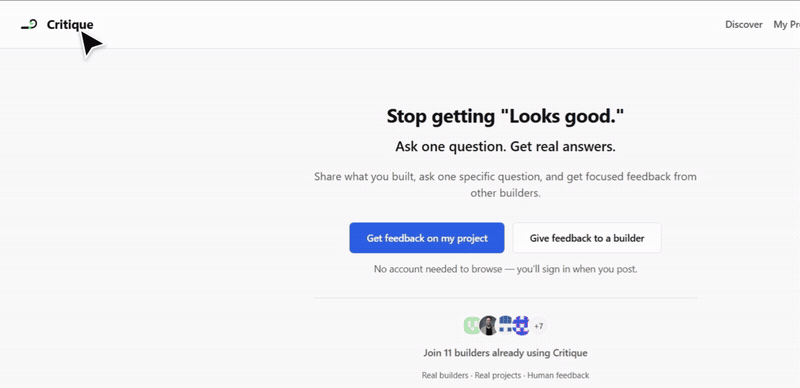
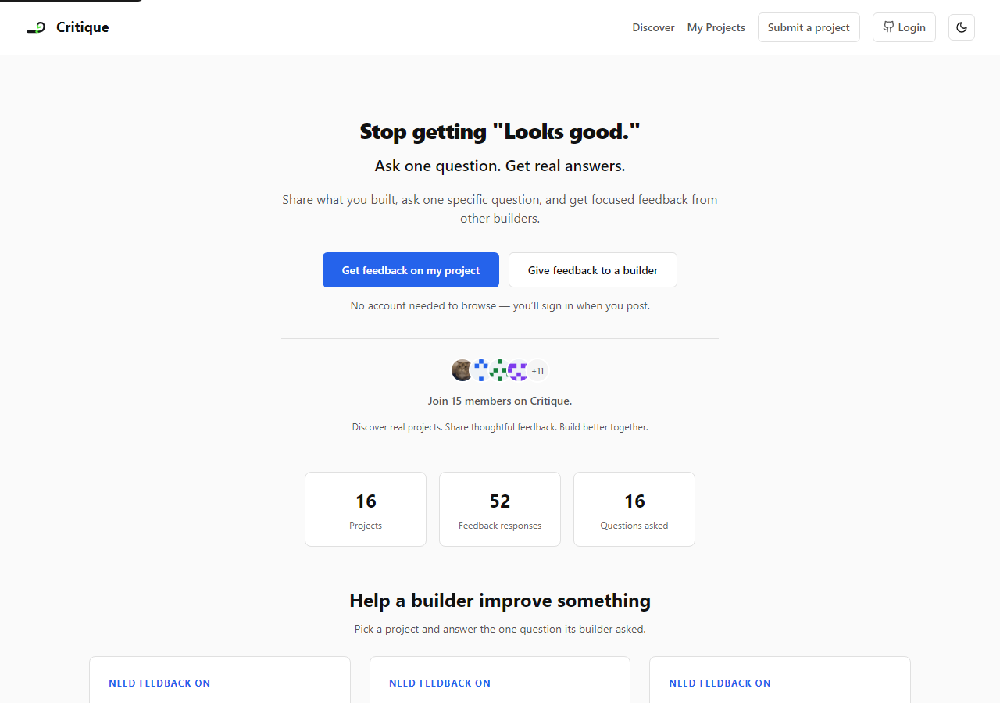
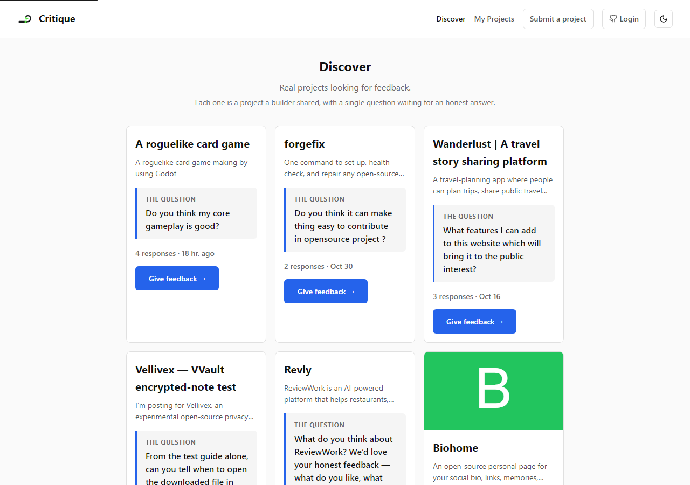

<p align="center">
  
</p>

<h1 align="center">Critique</h1>

<p align="center">
  <strong>Ask one question. Get real answers.</strong>
</p>

<p align="center">
  Critique は、あなたのプロジェクトに対する集中した・構造化された人間のフィードバックを
  得るためのオープンソースプラットフォームです。作りたいものと、ひとつだけの具体的な質問を
  共有し、プロジェクトを実際に見てくれた人々から反応を集めます。
</p>

<p align="center">
  <a href="https://github.com/BistaDinesh03/critique/actions/workflows/tests.yml"></a>
  <a href="https://github.com/BistaDinesh03/critique/actions/workflows/visual-tests.yml"></a>
  <a href="LICENSE"></a>
  <a href="https://github.com/BistaDinesh03/critique/stargazers"></a>
  <a href="https://github.com/BistaDinesh03/critique/network/members"></a>
  <a href="https://github.com/BistaDinesh03/critique/commits/main"></a>
</p>

<p align="center">
  <a href="https://critique.page/">Critique を試す</a> ·
  <a href="https://critique.page/discover">プロジェクトを見る</a> ·
  <a href="https://github.com/BistaDinesh03/critique">ソースコード</a> ·
  <a href="https://github.com/BistaDinesh03/critique/issues">Issues</a> ·
  <a href="https://github.com/BistaDinesh03/critique/discussions">Discussions</a> ·
  <a href="CONTRIBUTING.md">コントリビュート</a> ·
  <a href="SECURITY.md">セキュリティ</a>
</p>

<p align="center">
  <a href="README.md">English</a> ·
  <a href="README.zh-CN.md">简体中文</a> ·
  <strong>日本語</strong> ·
  <a href="README.es.md">Español</a>
</p>

> この文書は Critique の日本語訳です。**英語版の [README.md](README.md) が正典です**；
> 内容が食い違う場合は英語版が優先されます。

## 目次

- [Critique を見てみる](#critique-を見てみる)
- [何が問題か](#何が問題か)
- [解決策](#解決策)
- [仕組み](#仕組み)
- [機能](#機能)
- [フィードバックのモデル](#フィードバックのモデル)
- [フィードバックバッジ](#フィードバックバッジ)
- [Critique を試す](#critique-を試す)
- [スクリーンショット](#スクリーンショット)
- [技術スタック](#技術スタック)
- [アーキテクチャ](#アーキテクチャ)
- [はじめに](#はじめに)
- [環境変数](#環境変数)
- [データベース](#データベース)
- [テスト](#テスト)
- [アーキテクチャと API](#アーキテクチャと-api)
- [セキュリティとプライバシー](#セキュリティとプライバシー)
- [デプロイ](#デプロイ)
- [プロダクト分析（履歴）](#プロダクト分析履歴)
- [コントリビュート](#コントリビュート)
- [オープンソース](#オープンソース)
- [ライセンス](#ライセンス)

## Critique を見てみる

実際のプロダクトを 62 秒で巡るデモ動画です —— ホームページ、Discover フィード、
プロジェクトページ、そして作り手が受け取るフィードバック結果が含まれます。



フルのデモが見たい方は、[62秒の動画を再生](https://dineshbista.com.np/critique/watch.html)してください。
上のGIFは12秒のプレビューです。フルのデモは音声なしの62秒で、視聴ページの
プレーヤーは再生ボタンを押すまで動きません。オリジナルファイルがよければ
[直接MP4へのリンク](https://dineshbista.com.np/critique/videos/critique-overview.mp4)
（46.8 MB）をご利用ください。リポジトリ内のファイル：
[docs/videos/critique-overview.mp4](docs/videos/critique-overview.mp4)。

## 何が問題か

何かを何時間もかけて作っても、それが何であるか・何をするのか・なぜ重要なのかを
他の人が理解しているのかが分からないままです。「どう思う？」と尋ねても返ってくるのは
たいてい「良さそう！」という即座の一言 —— 禮儀正しいけれど、行動につながりません。

作り手は推測することになります：ユーザーはこのプロジェクトを理解したのだろうか？
実際に使うのだろうか？何を改善すべきか？曖昧なフィードバックは、どれにも答えません。

## 解決策

Critique は、その推測をひとつのはっきりしたシグナルで置き換えます。プロジェクトを共有し、
**ひとつの集中的な質問** —— 例：*"このアプリが何をするのか、10秒で分かりますか？"* ——
を投げ、実際の人々から構造化されたフィードバックを受け取ります。

質問をひとつに絞ることで回答は比較可能になり、どの回答も行動に移せるシグナルになります。
すべてのフィードバックはサイトを利用する人間から届きます。Critique に AI が生成した
回答は含まれません。

> ひとつのプロジェクト。ひとつの集中的な質問。本当の人間のフィードバック。

## 仕組み

<table>
  <tr>
    <td align="center"><strong>1. プロジェクトを作る</strong><br>作ったものとその機能を追加します。</td>
    <td align="center"><strong>2. ひとつの質問をぶつける</strong><br>最も知りたい、たったひとつのこと。</td>
    <td align="center"><strong>3. 人々に共有する</strong><br>リンクを、聞き手のいる場所へ送ります。</td>
    <td align="center"><strong>4. 構造化されたフィードバックから学ぶ</strong><br>すべての返信に評点が付き、任意で文章のアドバイスも添えられます。</td>
  </tr>
</table>

## 機能

- **Discover** —— フィードバックを求めるプロジェクトの公開フィード。決定論的な
  ランキング（必要性、鮮度、質問の質など）で並びます
- **My Projects** —— 自分の投稿を管理し、結果を見返す
- **Results ダッシュボード** —— プロジェクトごとの合計、分布バー、文章フィードバック、
  および CSV エクスポート
- **ひとつの質問** —— 各プロジェクトは1つの質問だけを提示し、2つの固定評価質問により
  返信を比較しやすく
- **非公開の文章アドバイス** —— プロジェクトに添付され、所有者にのみ表示
- **かんたん共有** —— 投稿後または My Projects から、X や Reddit に投稿、またはリンクをコピー
- **トップへ戻る** —— 長いページ用のアクセシブルなスクロールトップコントロール
- **印刷スタイル** —— プロジェクト詳細と結果ページをきれいに印刷
- **ダイナミックバッジ** —— ライブな返信数を示す SVG
- **設定可能な分析** —— `ANALYTICS_OWNER_USERNAMES` による分析ダッシュボードの
  所有者許可リスト
- **サインイン方法** —— GitHub OAuth またはパスワード不要のメールマジックリンク
- **プライバシー重視** —— 生の IP アドレスは保存せず、第三者のトラッキングスクリプトなし、
  分析データは最小限
- **オープンソース** —— 実装全体が MIT ライセンスで公開され、ローカルでそのまま動きます
- **SEO 対応** —— `robots.txt`、ダイナミックな `sitemap.xml`、ホームのソーシャルプレビューメタデータ

## フィードバックのモデル

すべての返信は、2つの核となる質問に答えます。

<table>
  <tr>
    <th align="center">プロジェクトは分かりやすいですか？</th>
    <th align="center">使いたいと思いますか？</th>
  </tr>
  <tr>
    <td align="center">とても分かりやすい<br>おおむね分かりやすい<br>分かりにくい</td>
    <td align="center">使う<br>もしかしたら<br>使わない</td>
  </tr>
</table>

> プロジェクトの所有者は、任意の文章アドバイスも受け取れます —— 所有者にのみ表示されます。

## フィードバックバッジ

すべてのプロジェクトには、ライブな返信数を示す埋め込み可能な SVG バッジがあります。

- **バッジのエンドポイント：** `GET /badge/{project_id}.svg` ——
  `https://critique.page/badge/PROJECT_ID.svg`
- **リンク先：** プロジェクトページ —— `https://critique.page/project/PROJECT_ID`

```markdown
[](https://critique.page/project/PROJECT_ID)
```

`PROJECT_ID` を自分のプロジェクト ID（Critique の URL に現れる数字）に
置き換えてください。カウントはリクエストごとにデータベースから描画されます。

## Critique を試す

> 自信のないプロジェクトがありますか？ひとつの質問を投げて、実際の人々がどう思うか見てみましょう。

<p align="center">
  <a href="https://critique.page/">
    
  </a>
</p>

[Critique を開く](https://critique.page/) ·
[プロジェクトを見る](https://critique.page/discover) ·
[プロジェクトを共有する](https://critique.page/)

## スクリーンショット

実際のアプリケーションのスクリーンショットです。

<p align="center">
  
</p>

<p align="center">
  
</p>

## 技術スタック

| レイヤ | 技術 |
|---|---|
| Web フレームワーク | FastAPI（Python 3.11+） |
| データアクセス | SQLAlchemy 2.x |
| データストア | SQLite（開発）、PostgreSQL（本番） |
| フロントエンド | ベニラ HTML/CSS/JavaScript —— ビルドステップなし |
| 認証 | GitHub OAuth とパスワード不要のメール（Resend） |
| デプロイ | Render ウェブサービス（`render.yaml`）+ Neon PostgreSQL |

## アーキテクチャ

```text
Browser — vanilla HTML/CSS/JavaScript
   │
   │  HTML pages + JSON API calls
   ▼
FastAPI — routes, auth, CSRF, rate limiting
   │
   │  SQLAlchemy ORM queries
   ▼
SQLAlchemy — models, validation, migrations
   ▼
SQLite (development)  /  PostgreSQL (production)
```

サーバーは `frontend/` のページをそのまま配信し、`/api/*` に JSON API を公開します。
フロントエンドにビルドステップはなく、SQLAlchemy 以外の ORM レイヤもありません。

<details>
<summary>リポジトリ構成</summary>

```text
backend/
  app/
    main.py                   App setup, page routes, /health, cache headers
    auth.py                   GitHub OAuth, email magic links, sessions
    csrf.py                   Double-submit-cookie CSRF protection
    config.py                 Environment-based settings
    database.py               Engine, table creation, additive migrations
    models.py                 SQLAlchemy models
    schemas.py                Pydantic request/response validation
    ranking.py                Deterministic Discover ranking
    rate_limit.py             In-memory per-endpoint rate limiting
    analytics.py              Event storage and visitor cookie
    email.py                  Magic-link email delivery (Resend)
    routes_projects.py        Project CRUD and Discover feed
    routes_responses.py       Feedback submission and listing
    routes_results.py         Aggregated results for owners
    stats.py                  Aggregate feedback statistics
    routes_badge.py           GET /badge/{id}.svg
    routes_stats.py           GET /api/stats
    routes_analytics.py       Event allowlist, /api/analytics/track
    routes_analytics_dashboard.py  Owner analytics endpoint
    routes_seo.py             robots.txt and sitemap.xml
  tests/                      pytest suite (API, security, frontend render)
frontend/                     HTML pages (vanilla JS, no build step)
static/                       CSS, JS, logos, favicon
docs/                         Setup guides, architecture, and API reference
scripts/                      Local launcher and maintainer scripts
.github/                      GitHub Actions CI (tests.yml, visual-tests.yml)
render.yaml                   Deployment config
```

</details>

## はじめに

**要件：** Python 3.11+、Git。Node.js（最近の任意のバージョン）は
フロントエンドのレンダリングテストにのみ必要で —— `node` が PATH になければ
これらのテストはスキップされます。

```bash
git clone https://github.com/BistaDinesh03/critique.git
cd critique
python scripts/quickstart.py
```

The launcher creates or reuses `.venv`, installs the requirements, creates `.env`
from the example if it is missing, and starts the development server. Existing
`.env` settings are preserved. On Windows, `py scripts/quickstart.py` also works;
on macOS/Linux, use `python3` if that is your Python command. Use `--port 8001`
if the default port is busy, and press Ctrl+C to stop.

<details>
<summary>Manual setup</summary>

```bash
python -m venv .venv
```

Activate the virtual environment:

```bash
# macOS / Linux
source .venv/bin/activate
```

```powershell
# Windows PowerShell
.venv\Scripts\Activate.ps1
```

Install dependencies, create your environment file, and start the server:

```bash
pip install -r requirements.txt
cp .env.example .env    # Windows: copy .env.example .env
cd backend
uvicorn app.main:app --reload
```

</details>

Open http://127.0.0.1:8000. SQLite tables are created automatically on
startup — no separate migration step.

Authentication is optional for local browsing; sign-in is only required to
submit or manage projects. Setup for GitHub OAuth and email magic links
(including the `RESEND_API_KEY` and `EMAIL_FROM` values email login needs)
is in [docs/github-oauth-setup.md](docs/github-oauth-setup.md).

## 環境変数

`.env.example` を `.env` にコピーし、必要なものを設定してください。`.env` は
gitignore されています —— 実際の認証情報は決してコミットしないでください。

| 変数 | 用途 | デフォルト / 備考 |
|---|---|---|
| `APP_ENV` | 環境識別子 | `development`。将来の本番専用挙動のために予約されており、現在は起動時に空でない `SECRET_KEY` を強制します。 |
| `APP_URL` | 公開ベース URL | `http://127.0.0.1:8000` |
| `SECRET_KEY` | セッショントークンと OAuth state を署名 | 本番環境では必須（未設定の場合、アプリは起動を拒否します）。本番以外で未設定の場合はプロセスごとのランダムなキーが使われるため、再起動後にセッションは維持されません。生成コマンド：`python -c "import secrets; print(secrets.token_hex(32))"` |
| `DATABASE_URL` | データベース接続文字列 | `sqlite:///./critique.db`；本番は PostgreSQL を使用 |
| `GITHUB_CLIENT_ID` | GitHub OAuth アプリのクライアント ID | 任意 —— GitHub ログインを有効化 |
| `GITHUB_CLIENT_SECRET` | GitHub OAuth アプリのシークレット | 任意 |
| `GITHUB_REDIRECT_URI` | OAuth コールバック URL | `http://127.0.0.1:8000/auth/callback` |
| `ANALYTICS_OWNER_USERNAMES` | 分析ダッシュボードにアクセスできるユーザー名のカンマ区切りリスト（大文字小文字を区別せず、空白や空の項目は無視） | 未設定時は `BistaDinesh03`。空にすると全員のアクセスを拒否します。 |
| `SESSION_COOKIE_SECURE` | HTTPS の背後では `true` に設定 | `false` |
| `SESSION_COOKIE_MAX_AGE` | セッションの有効期間（秒） | 任意；`604800`（7 日） |
| `RESEND_API_KEY` | マジックリンクメール用の Resend API キー | 任意 —— メールログインを有効化 |
| `EMAIL_FROM` | マジックリンクの送信元アドレス | 任意；Resend で検証済みであること |

## データベース

開発では SQLite（`critique.db`、gitignore 済み）を使用します —— これが
`DATABASE_URL` が未設定時のデフォルトです。起動時にアプリは `init_db()` を実行し、
テーブルを作成して SQLite と PostgreSQL 双方に対し軽量な追加型マイグレーションを
適用するため、単独のマイグレーション手順は不要です。本番では PostgreSQL を使用し、
`DATABASE_URL` はホスティング環境が提供し、リポジトリの外に置かれます。

## テスト

```bash
cd backend
GITHUB_CLIENT_ID=ci-test-client-id python -m pytest tests/ -q
```

Windows（PowerShell）の場合：

```powershell
cd backend
$env:GITHUB_CLIENT_ID = "ci-test-client-id"
python -m pytest tests/ -q
```

テストスイートは API の挙動、CSRF、レート制限、所有権チェック、プライバシールール、
ランキング、XSS、分析のバリデーション、認証フロー、SEO エンドポイント、そして
Node ベースの DOM ハーネスによるフロントエンドレンダリング（Node.js が無い場合は
スキップ）をカバーします。ローカルのトラブルシューティングのヒントは
[docs/troubleshooting.md](docs/troubleshooting.md) を参照してください。

バックエンドの行カバレッジを確認するには：

```bash
cd backend
python -m pytest tests/ -q --cov=app --cov-report=term-missing
```

## アーキテクチャと API

システム設計とコンポーネントの概要は [docs/architecture.md](docs/architecture.md) にあります。

JSON API のドキュメントは [docs/api.md](docs/api.md) にあります。主なカテゴリ：

- **認証** —— `/auth/*`：GitHub OAuth、メールマジックリンク、セッションチェック、CSRF トークン
- **プロジェクト** —— `/api/projects/`：作成、Discover フィード、所有者一覧、詳細、削除
- **フィードバック** —— `/api/projects/{id}/responses`：返信の投稿と取得
- **結果** —— `/api/projects/{id}/results`：全員向けの集計、所有者向けの文章アドバイス
- **バッジ** —— `/badge/{id}.svg`：ライブな返信数
- **統計と分析** —— `/api/stats`、`/api/analytics/track`
- **SEO** —— `robots.txt`、`sitemap.xml`

アプリ実行中は、インタラクティブなドキュメントが `/docs`（Swagger UI）と
`/redoc` で提供され、ヘルスチェックは `GET /health` で利用できます。

例 —— 現在フィードバックを求めているプロジェクトを一覧表示（公開、認証不要）：

```bash
curl -s https://critique.page/api/projects/
```

レスポンスはページネーションされています（`items`、`total`、`page`、`page_size`、
`total_pages`）。各項目にはプロジェクトの `title`、`question_text`、そして
ライブな `response_count` が含まれます。

## セキュリティとプライバシー

Critique はセキュリティとプライバシーを前提に設計されています：

| 保護 | 動作 |
|---|---|
| **CSRF 保護** | 状態を変更するすべてのリクエストで、`X-CSRF-Token` ヘッダ付きのダブルサブミット Cookie を使用。セッションは `HttpOnly`、`SameSite=Lax` の Cookie に置かれ、`SESSION_COOKIE_SECURE=true` のときは `Secure` 付き |
| **レート制限** | 認証とメールログイン、プロジェクトの作成と削除、フィードバックの投稿、そして分析 |
| **入力検証** | すべてのリクエストボディに Pydantic の検証。フィードバック値には厳格なパターン |
| **XSS 保護** | ユーザーが制御する出力はフロントエンドでエスケープされ、XSS 回帰テストでカバー |
| **認証と所有権チェック** | プロジェクトの所有権はクライアントのヘッダではなく、セッションに基づきサーバー側で検証 |
| **非公開の文章フィードバック** | アドバイスはプロジェクト所有者にのみ返却 |
| **安全なリダイレクト処理** | ログインの `return_to` はローカルパスの許可リストに対して検証 |
| **環境ベースのシークレット** | 認証情報は環境変数から来ており、リポジトリには保存されない |
| **最小限の分析** | イベントはサーバーサイドの許可リストで検証。第三者のトラッキングスクリプトなし。生の IP は保存せず（重複検出用の鍵付き HMAC-SHA-256 ダイジェストのみ。`SECRET_KEY` が変わらない限り同じ値を保持） |

[SECURITY.md](SECURITY.md) に完全な挙動と、脆弱性の報告方法が記載されています。

## デプロイ

デプロイは `render.yaml` で設定されています：Render のウェブサービスと
`APP_ENV=production` と `SESSION_COOKIE_SECURE=true` がそこで設定され、
シークレット —— `DATABASE_URL`、`SECRET_KEY`、OAuth 認証情報、メールキー —— は
`sync: false` として設定され、Render ダッシュボードで手動入力され、リポジトリには
保存されません。PostgreSQL は Neon 上で動作します。想定される変数の一覧は `render.yaml`
を参照してください。

## プロダクト分析（履歴）

リポジトリには 2 つの履歴的な分析スナップショットが含まれています。これらは
異なる時点で提供され、集計期間を伴わず、互いに一致していません。どちらも
現在のものとして提示されていません。

- [詳細な HTML レポート](docs/analytics-snapshot.html)
- [SVG スナップショット](docs/assets/analytics-overview.svg)

認可された所有者向けのライブダッシュボードは
`https://critique.page/api/analytics/dashboard` で利用できます。

## コントリビュート

コントリビューション、バグレポート、ドキュメントの改善、そして思慮深いプロダクトへの
フィードバックを歓迎します。始めやすい場所として、
[`good first issue`](https://github.com/BistaDinesh03/critique/labels/good%20first%20issue)
ラベルの付いた issue があります。

1. リポジトリをフォーク
2. 変更用のブランチを作成
3. 変更を加え、テストを追加
4. テストスイートを実行
5. プルリクエストを開く

[CONTRIBUTING.md](CONTRIBUTING.md) に完全なガイドラインがあり、
[初回コントリビューター向けの手順](docs/first-contributors.md) では、issue を
claim してプルリクエストを開くまでの流れを説明しています。
[SECURITY.md](SECURITY.md) には脆弱性の報告方法が、
[CODE_OF_CONDUCT.md](CODE_OF_CONDUCT.md) には参加時の行動規範が記載されています。

**作業対象を探していますか？** [検証済みのコントリビューター機会リスト](docs/contributor-opportunities.md)
を使ってください。ライブトラッカーと照合され、オープンで未割り当て、コメントで
claim されておらず、オープンなプルリクエストに紐付いていない issue だけが
掲載されるため、そこに載っているものは本当に利用可能です。古い
[docs/issue-roadmap.md](docs/issue-roadmap.md) は 2026-10-17 時点の歴史的記録です ——
文脈の参考にはなりますが、タスクの選定には使わないでください。issue は分野
（`frontend`、`backend`、`tests`、`accessibility`、`security`、`performance`）で
ラベル付けされており、開始前に
[issue #1](https://github.com/BistaDinesh03/critique/issues/1) で質問することもできます。

コントリビューターには、最初のプルリクエストの前に Critique 自体を少し
使う —— プロジェクトを投稿したりフィードバックを提供したり —— ことを推奨
しています。[CONTRIBUTING.md](CONTRIBUTING.md) にガイドラインとその例外が
説明されています。これは参加の障壁ではなく、プロダクトを理解するための方法です。

## オープンソース

Critique は MIT ライセンスのオープンソースです。バックエンド、フロントエンド、
テスト、デプロイ設定を含む実装全体は
[github.com/BistaDinesh03/critique](https://github.com/BistaDinesh03/critique) に
あります。issue とプルリクエストを歓迎します。

Critique が役に立ったなら、リポジトリにスターを付けていただけると嬉しいです。
より多くの開発者にプロジェクトを発見してもらう助けになります。無理強いはしません ——
コントリビューションやフィードバックも同じくらいありがたいです。

### コントリビューター

コード、テスト、ドキュメント、デザイン、フィードバックで Critique に貢献して
くださったすべての方に感謝します。初回および継続的なコントリビューターは
リリースノートと月次のコントリビューターサマリーで紹介されます（
[docs/contributor-tracking.md](docs/contributor-tracking.md) を参照）。掲載されるには、
マージされたプルリクエストを開いてください。リストの更新は自動ボットではなく、
メンテナーの編集によって行われます。

## ライセンス

MIT —— [LICENSE](LICENSE) を参照してください。
