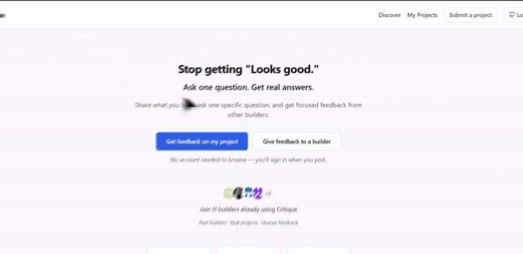

<p align="center">
  
</p>

<h1 align="center">Critique</h1>

<p align="center">
  <strong>Ask one question. Get real answers.</strong>
</p>

<p align="center">
  Critique is an open-source platform for focused, structured human feedback
  on your projects. Share what you're building, ask one specific question,
  and collect responses from people who actually see your project.
</p>

<p align="center">
  <a href="https://github.com/BistaDinesh03/critique/actions/workflows/tests.yml"></a>
  <a href="LICENSE"></a>
</p>

<p align="center">
  <a href="https://critique.page/">Try Critique</a> ·
  <a href="https://critique.page/discover">Explore projects</a> ·
  <a href="https://github.com/BistaDinesh03/critique">Source code</a> ·
  <a href="https://github.com/BistaDinesh03/critique/issues">Issues</a> ·
  <a href="CONTRIBUTING.md">Contributing</a>
</p>

<p align="center">
  <strong>English</strong> ·
  <a href="README.zh-CN.md">简体中文</a> ·
  <a href="README.ja.md">日本語</a> ·
  <a href="README.es.md">Español</a>
</p>

## See Critique in action

A 62-second walkthrough of the real product — the homepage, the Discover
feed, a project page, and the feedback results a builder receives.



**Want the full walkthrough? [Watch the 62-second video.](https://dineshbista.com.np/critique/watch.html)**

The GIF above is a 12-second preview; the full walkthrough runs 62 seconds with
no audio, and the watch-page player starts only when you press Play. Prefer the
original file? Use the [direct MP4 link](https://dineshbista.com.np/critique/videos/critique-overview.mp4)
(46.8 MB).<br />
Original file: [docs/videos/critique-overview.mp4](docs/videos/critique-overview.mp4)
— 1854×902, 30 fps, 62 s, H.264 MP4, 46.8 MB, committed to this repository
so it is included in every clone, and played from the GitHub Pages watch page.

## The problem

You can spend hours building something and still not know whether another
person understands what it is, what it does, or why it matters. Posting
"what do you think?" usually earns a quick "looks good!" — polite, but not
actionable.

Builders are left guessing: Did users understand the project? Would they
actually use it? What should be improved? Vague feedback answers none of
those questions.

## The solution

Critique replaces the guesswork with one clear signal. Share your project,
ask **one focused question** — for example, *"Would you understand what
this does in 10 seconds?"* — and receive structured feedback from real
people.

One question keeps the answers comparable, and every answer is signal you
can act on. All feedback comes from humans using the site; Critique
contains no AI-generated responses.

> One project. One focused question. Real human feedback.

## How it works

<table>
  <tr>
    <td align="center"><strong>1. Create a project</strong><br>Add what you built and what it does.</td>
    <td align="center"><strong>2. Ask one focused question</strong><br>The single thing you most want to know.</td>
    <td align="center"><strong>3. Share it with people</strong><br>Send the link wherever your audience is.</td>
    <td align="center"><strong>4. Learn from structured feedback</strong><br>Ratings for every response, plus optional written suggestions.</td>
  </tr>
</table>

## Features

- **Discover** — a public feed of projects asking for feedback, ranked
  deterministically (need, freshness, question quality, and more)
- **My Projects** — manage your submissions and revisit results
- **Results dashboard** — totals, distribution bars, and written feedback
  for each project
- **One focused question** — every project asks a single question, and two
  fixed rating questions make responses easy to scan and compare
- **Private written suggestions** — attached to the project, visible only
  to its owner
- **Simple sharing** — post to X or Reddit, or copy the link, right after
  submitting or from My Projects
- **Dynamic badge** — a live SVG response count for your README (below)
- **Sign-in options** — GitHub OAuth or a passwordless email magic link
- **Privacy-conscious** — no raw IP addresses stored, no third-party
  tracking scripts, minimal analytics data
- **Open source** — the complete implementation is public under the MIT
  License, and the app runs locally out of the box
- **SEO support** — `robots.txt`, a dynamic `sitemap.xml`, and homepage
  social-preview metadata

## Feedback model

Every response answers two core questions.

<table>
  <tr>
    <th align="center">Is the project clear?</th>
    <th align="center">Would you use it?</th>
  </tr>
  <tr>
    <td align="center">Very clear<br>Mostly clear<br>Confusing</td>
    <td align="center">Yes<br>Maybe<br>No</td>
  </tr>
</table>

> Project owners can also receive optional written suggestions — visible
> only to the owner.

## Feedback badge

Every project has an embeddable SVG badge with its live response count:

- **Badge endpoint:** `GET /badge/{project_id}.svg` —
  `https://critique.page/badge/PROJECT_ID.svg`
- **Links to:** the project page — `https://critique.page/project/PROJECT_ID`

```markdown
[](https://critique.page/project/PROJECT_ID)
```

Replace `PROJECT_ID` with your project's ID — the number in its Critique
URL. The count is rendered from the database on each request, and 1000+
displays as `1k+`.

## Try Critique

> Have a project you're unsure about? Ask one focused question and see what
> real people think.

<p align="center">
  <a href="https://critique.page/">
    
  </a>
</p>

[Open Critique](https://critique.page/) ·
[Explore projects](https://critique.page/discover)

## Built with

| Layer | Technology |
|---|---|
| Web framework | FastAPI (Python 3.11+) |
| Data access | SQLAlchemy 2.x |
| Datastores | SQLite (development), PostgreSQL (production) |
| Frontend | Vanilla HTML/CSS/JavaScript — no build step |
| Authentication | GitHub OAuth and passwordless email (Resend) |
| Deployment | Render (`render.yaml`) |

## Architecture

```text
Browser — vanilla HTML/CSS/JavaScript
   │
   │  HTML pages + JSON API calls
   ▼
FastAPI — routes, auth, CSRF, rate limiting
   │
   │  SQLAlchemy ORM queries
   ▼
SQLAlchemy — models, validation, migrations
   │
   ▼
SQLite (development)  /  PostgreSQL (production)
```

The server serves the pages in `frontend/` directly and exposes a JSON API
under `/api/*`. There is no frontend build step and no ORM layer beyond
SQLAlchemy.

<details>
<summary>Repository layout</summary>

```text
backend/
  app/
    main.py                   App setup, page routes, /health, cache headers
    auth.py                   GitHub OAuth, email magic links, sessions
    csrf.py                   Double-submit-cookie CSRF protection
    config.py                 Environment-based settings
    database.py               Engine, table creation, additive migrations
    models.py                 SQLAlchemy models
    schemas.py                Pydantic request/response validation
    ranking.py                Deterministic Discover ranking
    rate_limit.py             In-memory per-endpoint rate limiting
    analytics.py              Event storage and visitor cookie
    email.py                  Magic-link email delivery (Resend)
    routes_projects.py        Project CRUD and Discover feed
    routes_responses.py       Feedback submission and listing
    routes_results.py         Aggregated results for owners
    stats.py                  Aggregate feedback statistics
    routes_badge.py           GET /badge/{id}.svg
    routes_stats.py           GET /api/stats
    routes_analytics.py       Event allowlist, /api/analytics/track
    routes_analytics_dashboard.py  Owner analytics endpoint
    routes_seo.py             robots.txt and sitemap.xml
  tests/                      pytest suite (API, security, frontend render)
frontend/                     HTML pages (vanilla JS, no build step)
static/                       CSS, JS, logos, favicon
docs/                         Setup guides and API reference
render.yaml                   Deployment config
```

</details>

## Getting started

**Requirements:** Python 3.11+, Git. Node.js (any recent version) is only
needed for the frontend-render tests — they are skipped when `node` is not
on your PATH.

```bash
git clone https://github.com/BistaDinesh03/critique.git
cd critique
python -m venv .venv
```

Activate the virtual environment:

```bash
# macOS / Linux
source .venv/bin/activate
```

```powershell
# Windows PowerShell
.venv\Scripts\Activate.ps1
```

Install dependencies, create your environment file, and start the server:

```bash
pip install -r requirements.txt
cp .env.example .env    # Windows: copy .env.example .env
cd backend
uvicorn app.main:app --reload
```

Open http://127.0.0.1:8000. SQLite tables are created automatically on
startup — no separate migration step.

Authentication is optional for local browsing; sign-in is only required to
submit or manage projects. Setup for GitHub OAuth and email magic links
(including the `RESEND_API_KEY` and `EMAIL_FROM` values email login needs)
is in [docs/github-oauth-setup.md](docs/github-oauth-setup.md).

## Environment variables

Copy `.env.example` to `.env` and set what you need. `.env` is gitignored —
never commit real credentials.

| Variable | Purpose | Default / notes |
|---|---|---|
| `APP_ENV` | `development` or `production` | `development` |
| `APP_URL` | Public base URL | `http://127.0.0.1:8000` |
| `SECRET_KEY` | Signs session tokens and OAuth state | No default — generate: `python -c "import secrets; print(secrets.token_hex(32))"` |
| `DATABASE_URL` | Database connection string | `sqlite:///./critique.db`; use PostgreSQL in production |
| `GITHUB_CLIENT_ID` | GitHub OAuth app client ID | Optional — enables GitHub login |
| `GITHUB_CLIENT_SECRET` | GitHub OAuth app secret | Optional |
| `GITHUB_REDIRECT_URI` | OAuth callback URL | `http://127.0.0.1:8000/auth/callback` |
| `SESSION_COOKIE_SECURE` | Set `true` behind HTTPS | `false` |
| `SESSION_COOKIE_MAX_AGE` | Session lifetime in seconds | Optional; `604800` (7 days) |
| `RESEND_API_KEY` | Resend API key for magic-link emails | Optional — enables email login |
| `EMAIL_FROM` | From address for magic links | Optional; verified in Resend |

## Database

Development uses SQLite (`critique.db`, gitignored) — the default when
`DATABASE_URL` is unset. On startup the app runs `init_db()`, which creates
tables and applies lightweight, additive migrations for both SQLite and
PostgreSQL, so there is no separate migration step. Production uses
PostgreSQL, with `DATABASE_URL` provided by the hosting environment and kept
out of the repository.

## Testing

```bash
cd backend
python -m pytest tests/ -q
```

The suite passes cleanly. It covers API behavior, CSRF, rate
limiting, ownership checks, privacy rules, ranking, XSS, analytics
validation, authentication flows, SEO endpoints, and frontend rendering
through a Node-based DOM harness (skipped when Node.js is unavailable).

## API

The JSON API is documented in [docs/api.md](docs/api.md). Major categories:

- **Authentication** — `/auth/*`: GitHub OAuth, email magic links, session
  check, CSRF token
- **Projects** — `/api/projects/`: create, Discover feed, owner list,
  details, delete
- **Feedback** — `/api/projects/{id}/responses`: submit and read responses
- **Results** — `/api/projects/{id}/results`: aggregates for everyone,
  written suggestions for the owner
- **Badge** — `/badge/{id}.svg`: live response count
- **Stats and analytics** — `/api/stats`, `/api/analytics/track`
- **SEO** — `robots.txt`, `sitemap.xml`

While the app is running, interactive docs are served at `/docs` (Swagger
UI) and `/redoc`, and a health check is available at `GET /health`.

Example — list projects currently looking for feedback (public, no
authentication required):

```bash
curl -s https://critique.page/api/projects/
```

The response is paginated (`items`, `total`, `page`, `page_size`,
`total_pages`), and each item carries the project's `title`, its
`question_text`, and a live `response_count`.

## Security & privacy

Critique is designed with security and privacy in mind:

| Protection | Behavior |
|---|---|
| **CSRF protection** | Double-submit cookie with an `X-CSRF-Token` header on all state-changing requests; sessions live in an `HttpOnly`, `SameSite=Lax` cookie, with `Secure` when `SESSION_COOKIE_SECURE=true` (Render sets this) |
| **Rate limiting** | Auth and email login, project creation and deletion, feedback submission, and analytics |
| **Input validation** | Pydantic validation on every request body, with strict field patterns for feedback values |
| **XSS protection** | User-controlled output is escaped in the frontend and covered by XSS regression tests |
| **Authentication and ownership checks** | Project ownership is verified server-side from the session on every mutation, never from client-supplied headers |
| **Private written feedback** | Suggestions are returned only to the project owner |
| **Safe redirect handling** | Login `return_to` values are validated against a local-path allowlist |
| **Environment-based secrets** | Credentials come from environment variables and are never stored in the repository |
| **Minimal analytics** | Events validated against a server-side allowlist; no third-party tracking scripts; no raw IP addresses stored (only SHA-256 hashes for duplicate detection) |

[SECURITY.md](SECURITY.md) lists the full behavior and explains how to
report a vulnerability.

## Deployment

Deployment is configured in `render.yaml`: a Render web service with a
PostgreSQL database. `APP_ENV=production` and `SESSION_COOKIE_SECURE=true`
are set there; secrets — `DATABASE_URL`, `SECRET_KEY`, OAuth credentials,
and email keys — are marked `sync: false` and entered manually in the
Render dashboard, never stored in the repository. See `render.yaml` for the
full list of expected variables.

## Product analytics

> **Analytics snapshot** — point-in-time event totals. The reporting
> period was not supplied.

**Headline:** 1,443 page views · 263 unique visitors · 232 project views ·
20 feedback submissions.

**Funnel:** 232 project views → 92 feedback starts → 65 submit attempts →
20 successful submissions.


These totals are one recorded snapshot — **not live analytics**; the
figure does not update automatically. All percentages are **event
ratios** (one event count divided by another), not unique-user conversion
rates, and a single visitor can generate multiple events.

> **Two snapshots exist, and they differ.** This figure and the
> [HTML analytics report](docs/analytics-snapshot.html) were supplied at
> different times and do not carry the same totals (1,443 vs. 1,582 page
> views). Neither supplied a reporting period, so neither can be dated or
> reconciled here. Both datasets are left exactly as supplied — this is
> tracked in [issue #23](https://github.com/BistaDinesh03/critique/issues/23)
> for a proper resolution.

## Contributing

Contributions, bug reports, documentation improvements, and thoughtful
product feedback are welcome. A good place to start is an issue labeled
[`good first issue`](https://github.com/BistaDinesh03/critique/labels/good%20first%20issue).

1. Fork the repository
2. Create a branch for your change
3. Make your changes and add tests
4. Run the test suite
5. Open a pull request

[CONTRIBUTING.md](CONTRIBUTING.md) has the full guidelines, and
[SECURITY.md](SECURITY.md) explains how to report vulnerabilities.

**Looking for something to work on?** Start with the curated plan in
[docs/issue-roadmap.md](docs/issue-roadmap.md) — 50 reviewed issues with the
problem, scope, acceptance criteria, difficulty and relevant files spelled
out for each. Issues are also labeled by area (`frontend`, `backend`,
`tests`, `accessibility`, `security`, `performance`), and questions are
welcome in [issue #1](https://github.com/BistaDinesh03/critique/issues/1)
before you begin.

Contributors are also encouraged to spend a little time using Critique
itself — submitting a project or giving feedback — before their first pull
request. [CONTRIBUTING.md](CONTRIBUTING.md) explains the guideline and its
exceptions; it is a way to understand the product, not a barrier to
contributing.

## Open source

Critique is open source under the MIT License. The complete implementation
— backend, frontend, tests, and deployment configuration — lives at
[github.com/BistaDinesh03/critique](https://github.com/BistaDinesh03/critique).
Issues and pull requests are welcome.

## License

MIT — see [LICENSE](LICENSE).
