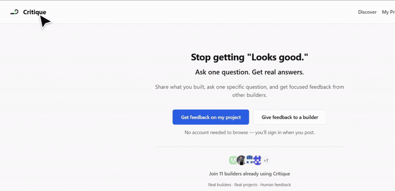

<p align="center">
  
</p>

<h1 align="center">Critique</h1>

<p align="center">
  <strong>Ask one question. Get real answers.</strong>
</p>

<p align="center">
  Critique is an open-source platform for focused human feedback. Share a
  project, ask one specific question, and see what real people think.
</p>

<p align="center">
  <a href="https://critique.page/">Try Critique</a> ·
  <a href="https://critique.page/discover">Explore projects</a> ·
  <a href="CONTRIBUTING.md">Contribute</a> ·
  <a href="https://github.com/BistaDinesh03/critique/stargazers">Star on GitHub</a>
</p>

<p align="center">
  <a href="https://github.com/BistaDinesh03/critique/actions/workflows/tests.yml"></a>
  <a href="LICENSE"></a>
</p>

<p align="center">
  <strong>English</strong> ·
  <a href="README.zh-CN.md">简体中文</a> ·
  <a href="README.ja.md">日本語</a> ·
  <a href="README.es.md">Español</a>
</p>

## See Critique in action

A short preview of the real product: the homepage, Discover, a project page,
and the results a builder receives.



[Watch the full walkthrough](docs/videos/critique-overview.mp4). It has no audio.

## What Critique does

You share something you built and ask one focused question, such as “Would you
understand what this does in 10 seconds?” Other builders answer two quick
ratings and can leave an optional written suggestion. You get a small results
page that is easy to scan and act on.

Ratings and counts are public. Written suggestions are private and go only to
the project owner.

## The problem

“What do you think?” usually gets “looks good.” It is polite, but it does not
tell you whether someone understood the project, would use it, or knows what to
improve.

## What makes it different

- One project, one focused question. The answers stay comparable.
- Human feedback only. Critique does not generate responses with AI.
- A fixed, small set of ratings plus an optional written note.
- Written notes stay with the owner, not in the public feed.
- The whole implementation is open source under the MIT License.

## How it works

1. **Submit your project.** Add a description, a link, and one question.
2. **Share the link.** Other builders open the project and answer the question.
3. **Read the results.** See the distribution, read private suggestions, and
   improve what you built.

You can also give feedback to other builders without submitting a project.

## Use Critique

- [Try Critique](https://critique.page/) — submit a project or give feedback.
- [Explore projects](https://critique.page/discover) — browse what other
  builders are asking about.
- [Submit a project](https://critique.page/) — start with one focused question.
- [Give feedback](https://critique.page/discover) — open a project and answer
  its question.

Browsing is public. Sign in with GitHub or a passwordless email link when you
want to submit a project, give feedback, or manage your own projects.

## Feedback model

Every response answers two short questions:

| Is the project clear? | Would you use it? |
|---|---|
| Very clear / Mostly clear / Confusing | Yes / Maybe / No |

The owner can also receive an optional written suggestion. Other visitors see
the aggregate signal, not the written text.

## Features

- Public Discover feed with search and “hide projects I have answered”
- Project pages with the maker’s question and a short feedback form
- Results dashboard with counts, distribution bars, and small-sample context
- Private written suggestions and owner-only CSV export
- My Projects for managing your submissions
- Share actions for X, Reddit, copy link, and copy post
- Live SVG badge with each project’s response count
- GitHub OAuth and passwordless email sign-in
- `robots.txt`, `sitemap.xml`, RSS feed, and social-preview metadata
- Privacy-conscious analytics: no raw IP addresses and no third-party scripts

## Feedback badge

Every project has an embeddable SVG badge. It shows the live response count and
links back to the project.

```markdown
[](https://critique.page/project/PROJECT_ID)
```

Replace `PROJECT_ID` with the number in the project URL. The badge is rendered
from the database on each request.

## Current status

Critique is an early-stage project maintained by one independent developer. The
core flow works, and the repository is open. Expect rough edges. Issues,
questions, and small pull requests are welcome.

## Built with

| Layer | Technology |
|---|---|
| Backend | FastAPI, SQLAlchemy 2.x, Pydantic |
| Frontend | Plain HTML, CSS, and JavaScript — no build step |
| Database | SQLite in development, PostgreSQL in production |
| Authentication | GitHub OAuth and passwordless email via Resend |
| Hosting | Render web service with Neon PostgreSQL |

## Architecture

The server serves the pages in `frontend/` and exposes a JSON API under
`/api/*`. Routes, validation, authentication, and rate limiting live in
`backend/app/`. There is no frontend build step.

See [docs/architecture.md](docs/architecture.md) for the component overview and
[docs/database-migrations.md](docs/database-migrations.md) for the database
migration contract.

## Getting started

Requirements: Python 3.11+ and Git. Node.js is only needed for the
frontend-render tests; those tests are skipped when `node` is not on `PATH`.

```bash
git clone https://github.com/BistaDinesh03/critique.git
cd critique
python scripts/quickstart.py
```

The launcher creates or reuses `.venv`, installs dependencies, creates `.env`
from the example if needed, and starts the server at http://127.0.0.1:8000.

For manual setup, shell-specific activation commands, and Windows notes, see
[docs/contributing-start.md](docs/contributing-start.md). Authentication is
optional for local browsing.

## Environment variables

Copy `.env.example` to `.env` and change only what you need. `.env` is
gitignored; never commit real credentials.

| Variable | Purpose |
|---|---|
| `APP_URL` | Public base URL; defaults to `http://127.0.0.1:8000` |
| `SECRET_KEY` | Required in production; sessions use a random key locally if unset |
| `DATABASE_URL` | Defaults to SQLite; use PostgreSQL in production |
| `GITHUB_CLIENT_ID` / `GITHUB_CLIENT_SECRET` | Optional GitHub login |
| `RESEND_API_KEY` / `EMAIL_FROM` | Optional email magic-link login |
| `ANALYTICS_OWNER_USERNAMES` | Usernames allowed to open the analytics dashboard |

See [docs/github-oauth-setup.md](docs/github-oauth-setup.md) for sign-in setup
and [docs/troubleshooting.md](docs/troubleshooting.md) for common local issues.

## Database

Development uses a local SQLite file and creates tables on startup. Production
uses PostgreSQL. There is no separate migration command; existing tables are
changed by guarded, additive migrations in `backend/app/database.py`.

## Testing

```bash
cd backend
GITHUB_CLIENT_ID=ci-test-client-id python -m pytest tests/ -q
```

On Windows PowerShell:

```powershell
cd backend
$env:GITHUB_CLIENT_ID = "ci-test-client-id"
python -m pytest tests/ -q
```

The suite covers API behavior, security rules, privacy, authentication, SEO,
analytics validation, and frontend rendering through a Node-based harness when
Node.js is available. Do not trust a hardcoded test count; read pytest’s own
summary.

## API

The JSON API is documented in [docs/api.md](docs/api.md). Interactive docs are
served at `/docs` and `/redoc` while the app is running. A public example:

```bash
curl -s https://critique.page/api/projects/
```

The response is paginated and includes each project’s title, question, and
response count. See [docs/feedback-reliability.md](docs/feedback-reliability.md)
for how feedback submissions can end and how to diagnose failures.

## Security & privacy

| Area | Behavior |
|---|---|
| Sessions | `HttpOnly`, `SameSite=Lax` cookies; `Secure` when configured |
| CSRF | Double-submit token on state-changing requests, with the documented analytics exception |
| Feedback | Written suggestions are returned only to the project owner |
| Analytics | Allowlisted events, no raw IP addresses, no feedback text, no third-party trackers |
| Secrets | Supplied through environment variables, never stored in the repository |

[SECURITY.md](SECURITY.md) explains the full behavior and how to report a
vulnerability. [CODE_OF_CONDUCT.md](CODE_OF_CONDUCT.md) covers community
participation.

## Analytics

The app stores a small set of allowlisted events for funnel measurement. There
are two historical snapshots in the repository; they have no reporting period
and are not presented as current:

- [Detailed HTML snapshot](docs/analytics-snapshot.html)
- [SVG snapshot](docs/assets/analytics-overview.svg)

## Deployment

Deployment is configured in `render.yaml`: a Render web service with production
environment settings and PostgreSQL on Neon. Secrets are entered in the hosting
dashboard and kept out of the repository.

## Contributing

Start with [CONTRIBUTING.md](CONTRIBUTING.md) and the
[first-contribution guide](docs/first-contribution.md). The usual path is:

1. Fork the repository and create a branch.
2. Pick an issue that is still available and comment on it to claim it.
3. Make a focused change and add or update tests where relevant.
4. Run the tests and `git diff --check`.
5. Open a pull request describing what changed and why.

### Good first issues

These were open, unassigned, and had no open PR on 2026-11-28. Check the live
issue state again before you start.

- [#901 — correct the feedback progress count](https://github.com/BistaDinesh03/critique/issues/901)
- [#903 — explain who sees written feedback](https://github.com/BistaDinesh03/critique/issues/903)

More beginner work is available under the
[`good first issue` label](https://github.com/BistaDinesh03/critique/labels/good%20first%20issue).

## Contributor opportunities

The [contributor opportunities page](docs/contributor-opportunities.md) is a
curated shortlist with the checks used to verify it. Treat it as a starting
point, not a reservation: confirm that an issue is still open, unassigned, and
unclaimed before writing code. The older
[docs/issue-roadmap.md](docs/issue-roadmap.md) is a dated record, not a task
list.

## License

MIT — see [LICENSE](LICENSE). If Critique is useful to you, a GitHub star helps
other developers find it. No pressure: feedback and contributions matter just
as much.
