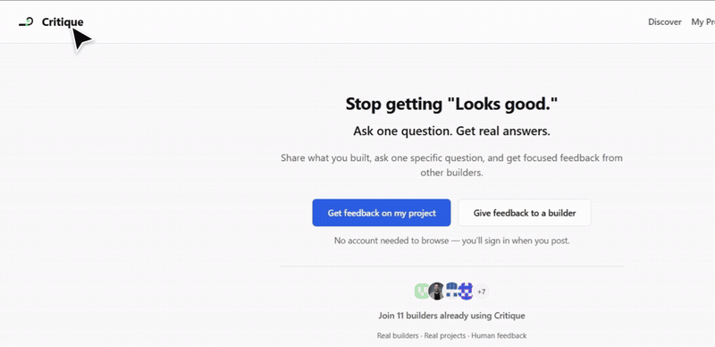
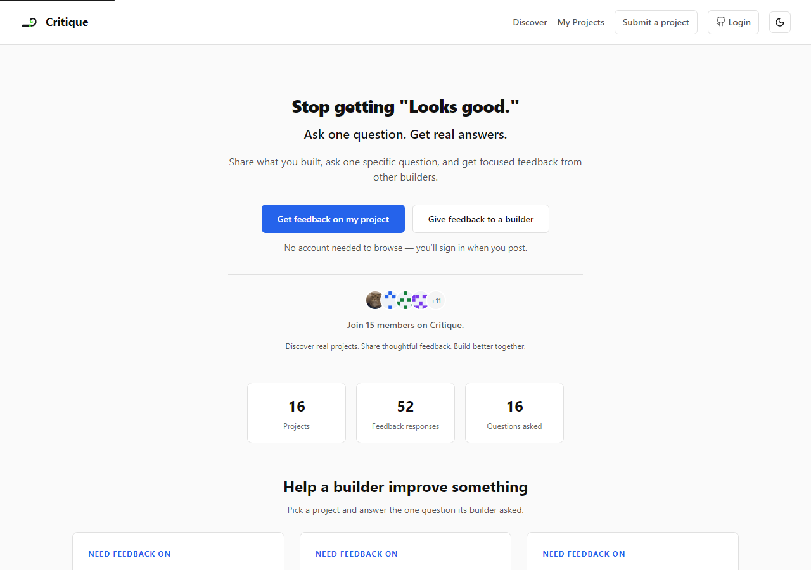
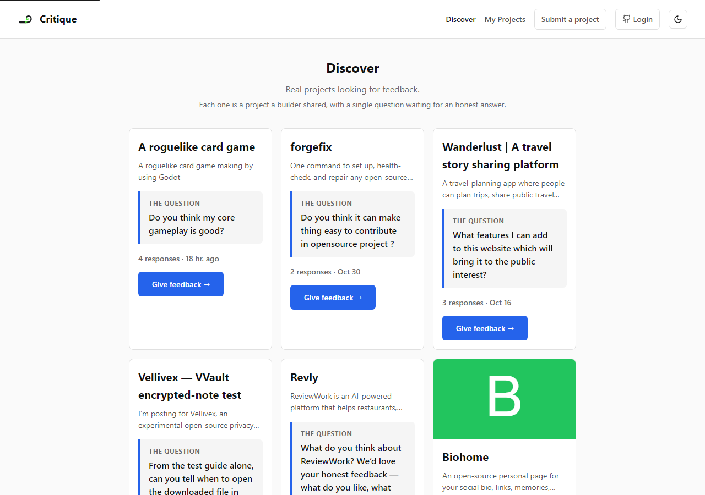

<p align="center">
  
</p>

<h1 align="center">Critique</h1>

<p align="center">
  <strong>Ask one question. Get real answers.</strong>
</p>

<p align="center">
  Critique 是一个面向项目结构化人类反馈的开源平台。分享你正在构建的内容，提出一个
  具体问题，收集真正看过你作品的人给出的反馈。
</p>

<p align="center">
  <a href="https://github.com/BistaDinesh03/critique/actions/workflows/tests.yml"></a>
  <a href="https://github.com/BistaDinesh03/critique/actions/workflows/visual-tests.yml"></a>
  <a href="LICENSE"></a>
  <a href="https://github.com/BistaDinesh03/critique/stargazers"></a>
  <a href="https://github.com/BistaDinesh03/critique/network/members"></a>
  <a href="https://github.com/BistaDinesh03/critique/commits/main"></a>
</p>

<p align="center">
  <a href="https://critique.page/">试用 Critique</a> ·
  <a href="https://critique.page/discover">浏览项目</a> ·
  <a href="https://github.com/BistaDinesh03/critique">源代码</a> ·
  <a href="https://github.com/BistaDinesh03/critique/issues">Issues</a> ·
  <a href="https://github.com/BistaDinesh03/critique/discussions">Discussions</a> ·
  <a href="CONTRIBUTING.md">贡献</a> ·
  <a href="SECURITY.md">安全</a>
</p>

<p align="center">
  <a href="README.md">English</a> ·
  <strong>简体中文</strong> ·
  <a href="README.ja.md">日本語</a> ·
  <a href="README.es.md">Español</a>
</p>

> 本文档是 Critique 的简体中文译本。**英文 [README.md](README.md) 为正典**；
> 如有不一致，以英文版为准。

## 目录

- [观看 Critique 演示](#观看-critique-演示)
- [问题](#问题)
- [解决方案](#解决方案)
- [工作方式](#工作方式)
- [功能](#功能)
- [反馈模型](#反馈模型)
- [反馈徽章](#反馈徽章)
- [试用 Critique](#试用-critique)
- [截图](#截图)
- [技术栈](#技术栈)
- [架构](#架构)
- [快速开始](#快速开始)
- [环境变量](#环境变量)
- [数据库](#数据库)
- [测试](#测试)
- [架构与 API](#架构与-api)
- [安全与隐私](#安全与隐私)
- [部署](#部署)
- [产品分析（历史）](#产品分析历史)
- [贡献](#贡献)
- [开源](#开源)
- [许可证](#许可证)

## 观看 Critique 演示

62 秒的真实产品演示：首页、Discover 信息流、项目页面，以及构建者收到的
反馈结果。



想看完整演示？[观看 62 秒视频。](https://dineshbista.com.np/critique/watch.html)
上面的 GIF 是 12 秒预览。完整演示 62 秒，无音频，播放器只在你按下播放后开始。
更喜欢原始文件？使用[直接 MP4 链接](https://dineshbista.com.np/critique/videos/critique-overview.mp4)
（46.8 MB）。原始文件：[docs/videos/critique-overview.mp4](docs/videos/critique-overview.mp4)。

## 问题

你可能花几小时构建了东西，却仍不知道别人是否理解它是什么、做什么、为什么重要。
发布“你觉得怎么样？”通常只会得到一句快速的“看起来不错！”——有礼貌，但不可执行。

构建者只能猜测：用户理解这个项目了吗？他们真的会用吗？应该改进什么？
模糊的反馈无法回答这些问题。

## 解决方案

Critique 用一个明确的信号取代猜测。分享你的项目，提出**一个聚焦的问题**
——例如，*“用户能在 10 秒内明白这个应用做什么吗？”*——并接收来自真实用户
的结构化反馈。

一个问题让回答可比较，每个回答都是可执行的信号。所有反馈都来自使用该站点的
真人；Critique 不包含 AI 生成的回复。

> 一个项目。一个聚焦的问题。真实的人类反馈。

## 工作方式

<table>
  <tr>
    <td align="center"><strong>1. 创建项目</strong><br>添加你构建的内容及其功能。</td>
    <td align="center"><strong>2. 提出一个聚焦的问题</strong><br>你最想知道的那一件事。</td>
    <td align="center"><strong>3. 分享给人们</strong><br>把链接发到你的受众所在之处。</td>
    <td align="center"><strong>4. 从结构化反馈中学习</strong><br>每条回复都有评分，还可附带书面建议。</td>
  </tr>
</table>

## 功能

- **Discover** —— 寻求反馈的项目的公开信息流，按确定性规则排序
  （需求、新鲜度、问题质量等）
- **My Projects** —— 管理你的提交并回顾结果
- **Results 仪表盘** —— 每个项目的总数、分布条、书面反馈，以及 CSV 导出
- **一个聚焦的问题** —— 每个项目只问一个问题，两个固定评分问题让回复易于
  扫描和比较
- **私有书面建议** —— 附加到项目，仅所有者可见
- **简单分享** —— 提交后或在 My Projects 中发布到 X 或 Reddit，或复制链接
- **回到顶部** —— 长页面的无障碍滚动到顶部控件
- **打印样式** —— 项目详情和结果页面的整洁打印
- **动态徽章** —— 显示实时回复数的 SVG
- **可配置分析** —— 通过 `ANALYTICS_OWNER_USERNAMES` 配置分析仪表盘所有者
  允许列表
- **登录方式** —— GitHub OAuth 或无密码邮箱魔法链接
- **隐私优先** —— 不存储原始 IP 地址，无第三方跟踪脚本，分析数据最小化
- **开源** —— 完整实现基于 MIT 许可证公开，应用可开箱即用本地运行
- **SEO 支持** —— `robots.txt`、动态 `sitemap.xml`、首页社交预览元数据

## 反馈模型

每条回复回答两个核心问题。

<table>
  <tr>
    <th align="center">项目清楚吗？</th>
    <th align="center">你会用吗？</th>
  </tr>
  <tr>
    <td align="center">非常清楚<br>基本清楚<br>令人困惑</td>
    <td align="center">会<br>也许<br>不会</td>
  </tr>
</table>

> 项目所有者还可以收到可选的书面建议 —— 仅所有者可见。

## 反馈徽章

每个项目都有一个可嵌入的 SVG 徽章，显示实时回复数：

- **徽章端点：** `GET /badge/{project_id}.svg` ——
  `https://critique.page/badge/PROJECT_ID.svg`
- **链接到：** 项目页面 —— `https://critique.page/project/PROJECT_ID`

```markdown
[](https://critique.page/project/PROJECT_ID)
```

将 `PROJECT_ID` 替换为你的项目 ID —— 它是 Critique URL 中的数字。
计数在每次请求时从数据库渲染。

## 试用 Critique

> 有不确定的项目？提出一个聚焦的问题，看看真实的人怎么想。

<p align="center">
  <a href="https://critique.page/">
    
  </a>
</p>

[打开 Critique](https://critique.page/) ·
[浏览项目](https://critique.page/discover) ·
[分享你的项目](https://critique.page/)

## 截图

运行中应用的真实截图。

<p align="center">
  
</p>

<p align="center">
  
</p>

## 技术栈

| 层级 | 技术 |
|---|---|
| Web 框架 | FastAPI（Python 3.11+） |
| 数据访问 | SQLAlchemy 2.x |
| 数据存储 | SQLite（开发）、PostgreSQL（生产） |
| 前端 | 原生 HTML/CSS/JavaScript —— 无构建步骤 |
| 认证 | GitHub OAuth 和无密码邮箱（Resend） |
| 部署 | Render 网络服务（`render.yaml`）+ Neon PostgreSQL |

## 架构

```text
Browser — vanilla HTML/CSS/JavaScript
   │
   │  HTML pages + JSON API calls
   ▼
FastAPI — routes, auth, CSRF, rate limiting
   │
   │  SQLAlchemy ORM queries
   ▼
SQLAlchemy — models, validation, migrations
   ▼
SQLite (development)  /  PostgreSQL (production)
```

服务器直接提供 `frontend/` 中的页面，并在 `/api/*` 下暴露 JSON API。
没有前端构建步骤，ORM 层仅 SQLAlchemy。

<details>
<summary>仓库结构</summary>

```text
backend/
  app/
    main.py                   App setup, page routes, /health, cache headers
    auth.py                   GitHub OAuth, email magic links, sessions
    csrf.py                   Double-submit-cookie CSRF protection
    config.py                 Environment-based settings
    database.py               Engine, table creation, additive migrations
    models.py                 SQLAlchemy models
    schemas.py                Pydantic request/response validation
    ranking.py                Deterministic Discover ranking
    rate_limit.py             In-memory per-endpoint rate limiting
    analytics.py              Event storage and visitor cookie
    email.py                  Magic-link email delivery (Resend)
    routes_projects.py        Project CRUD and Discover feed
    routes_responses.py       Feedback submission and listing
    routes_results.py         Aggregated results for owners
    stats.py                  Aggregate feedback statistics
    routes_badge.py           GET /badge/{id}.svg
    routes_stats.py           GET /api/stats
    routes_analytics.py       Event allowlist, /api/analytics/track
    routes_analytics_dashboard.py  Owner analytics endpoint
    routes_seo.py             robots.txt and sitemap.xml
  tests/                      pytest suite (API, security, frontend render)
frontend/                     HTML pages (vanilla JS, no build step)
static/                       CSS, JS, logos, favicon
docs/                         Setup guides, architecture, and API reference
scripts/                      Local launcher and maintainer scripts
.github/                      GitHub Actions CI (tests.yml, visual-tests.yml)
render.yaml                   Deployment config
```

</details>

## 快速开始

**要求：** Python 3.11+、Git。Node.js（任意较新版本）仅用于
前端渲染测试 —— 当 `node` 不在 PATH 中时，这些测试会被跳过。

```bash
git clone https://github.com/BistaDinesh03/critique.git
cd critique
python scripts/quickstart.py
```

启动器会创建或复用 `.venv`，安装依赖，如果缺少则从示例创建 `.env`，
并启动开发服务器。现有的 `.env` 设置会被保留。在 Windows 上，`py scripts/quickstart.py`
也可以；在 macOS/Linux 上，如果你的 Python 命令是 `python3`，请使用它。默认端口
被占用时使用 `--port 8001`，按 Ctrl+C 停止。

<details>
<summary>手动设置</summary>

```bash
python -m venv .venv
```

激活虚拟环境：

```bash
# macOS / Linux
source .venv/bin/activate
```

```powershell
# Windows PowerShell
.venv\Scripts\Activate.ps1
```

安装依赖、创建环境文件并启动服务器：

```bash
pip install -r requirements.txt
cp .env.example .env    # Windows: copy .env.example .env
cd backend
uvicorn app.main:app --reload
```

</details>

打开 http://127.0.0.1:8000。SQLite 表在启动时自动创建 ——
无需单独的迁移步骤。

本地浏览不需要认证；仅在提交或管理项目时需要登录。GitHub OAuth 和
邮箱魔法链接的设置（包括邮件登录需要的 `RESEND_API_KEY` 和 `EMAIL_FROM`
值）见 [docs/github-oauth-setup.md](docs/github-oauth-setup.md)。

## 环境变量

将 `.env.example` 复制为 `.env` 并设置所需内容。`.env` 已被 gitignore ——
永远不要提交真实凭据。

| 变量 | 用途 | 默认 / 说明 |
|---|---|---|
| `APP_ENV` | 环境标识符 | `development`。为将来的生产专用行为保留；目前仅在启动时强制非空 `SECRET_KEY`。 |
| `APP_URL` | 公共基础 URL | `http://127.0.0.1:8000` |
| `SECRET_KEY` | 签署会话令牌和 OAuth state | 生产环境必需（未设置时应用拒绝启动）；非生产环境下未设置时使用每进程随机密钥，因此重启后会话不会保留。生成：`python -c "import secrets; print(secrets.token_hex(32))"` |
| `DATABASE_URL` | 数据库连接字符串 | `sqlite:///./critique.db`；生产环境使用 PostgreSQL |
| `GITHUB_CLIENT_ID` | GitHub OAuth 应用客户端 ID | 可选 —— 启用 GitHub 登录 |
| `GITHUB_CLIENT_SECRET` | GitHub OAuth 应用密钥 | 可选 |
| `GITHUB_REDIRECT_URI` | OAuth 回调 URL | `http://127.0.0.1:8000/auth/callback` |
| `ANALYTICS_OWNER_USERNAMES` | 允许访问分析仪表盘的用户名逗号分隔列表（不区分大小写；空白和空项被忽略） | 未设置时默认 `BistaDinesh03`。设为空值则拒绝所有人访问。 |
| `SESSION_COOKIE_SECURE` | HTTPS 背后设为 `true` | `false` |
| `SESSION_COOKIE_MAX_AGE` | 会话有效期（秒） | 可选；`604800`（7 天） |
| `RESEND_API_KEY` | 魔法链接邮件的 Resend API 密钥 | 可选 —— 启用邮箱登录 |
| `EMAIL_FROM` | 魔法链接的发件地址 | 可选；需在 Resend 中验证 |

## 数据库

开发使用 SQLite（`critique.db`，已 gitignore）—— 这是 `DATABASE_URL`
未设置时的默认值。启动时应用运行 `init_db()`，创建表并为 SQLite 和
PostgreSQL 应用轻量的增量迁移，因此无需单独的迁移步骤。生产环境使用
PostgreSQL，`DATABASE_URL` 由托管环境提供，不进入仓库。

## 测试

```bash
cd backend
GITHUB_CLIENT_ID=ci-test-client-id python -m pytest tests/ -q
```

Windows（PowerShell）：

```powershell
cd backend
$env:GITHUB_CLIENT_ID = "ci-test-client-id"
python -m pytest tests/ -q
```

测试套件覆盖 API 行为、CSRF、速率限制、所有权检查、隐私规则、排名、XSS、
分析验证、认证流程、SEO 端点，以及通过基于 Node 的 DOM harness 进行的
前端渲染（Node.js 不可用时跳过）。本地故障排查提示见
[docs/troubleshooting.md](docs/troubleshooting.md)。

查看后端行覆盖率：

```bash
cd backend
python -m pytest tests/ -q --cov=app --cov-report=term-missing
```

## 架构与 API

系统设计与组件概览见 [docs/architecture.md](docs/architecture.md)。

JSON API 文档见 [docs/api.md](docs/api.md)。主要类别：

- **认证** —— `/auth/*`：GitHub OAuth、邮箱魔法链接、会话检查、CSRF 令牌
- **项目** —— `/api/projects/`：创建、Discover 信息流、所有者列表、详情、删除
- **反馈** —— `/api/projects/{id}/responses`：提交和读取回复
- **结果** —— `/api/projects/{id}/results`：所有人可见的聚合，所有者可见的书面建议
- **徽章** —— `/badge/{id}.svg`：实时回复数
- **统计与分析** —— `/api/stats`、`/api/analytics/track`
- **SEO** —— `robots.txt`、`sitemap.xml`

应用运行时，交互式文档位于 `/docs`（Swagger UI）和 `/redoc`，健康检查
位于 `GET /health`。

示例 —— 列出当前寻求反馈的项目（公开，无需认证）：

```bash
curl -s https://critique.page/api/projects/
```

响应已分页（`items`、`total`、`page`、`page_size`、`total_pages`），
每项包含项目的 `title`、`question_text` 和实时 `response_count`。

## 安全与隐私

Critique 以安全与隐私为设计前提：

| 保护 | 行为 |
|---|---|
| **CSRF 保护** | 所有状态变更请求使用双提交 Cookie 与 `X-CSRF-Token` 头；会话位于 `HttpOnly`、`SameSite=Lax` 的 Cookie 中，`SESSION_COOKIE_SECURE=true` 时为 `Secure` |
| **速率限制** | 认证与邮箱登录、项目创建与删除、反馈提交、分析 |
| **输入验证** | 所有请求体使用 Pydantic 验证，反馈值有严格字段模式 |
| **XSS 保护** | 用户控制的输出在前端被转义，并由 XSS 回归测试覆盖 |
| **认证与所有权检查** | 项目所有权在每次变更时基于会话在服务端验证，从不基于客户端提供的头 |
| **私有书面反馈** | 建议仅返回给项目所有者 |
| **安全重定向处理** | 登录 `return_to` 值对照本地路径允许列表验证 |
| **环境变量密钥** | 凭据来自环境变量，从不存储在仓库中 |
| **最小化分析** | 事件对照服务端允许列表验证；无第三方跟踪脚本；不存储原始 IP（仅用于重复检测的键控 HMAC-SHA-256 摘要，`SECRET_KEY` 不变时保持稳定） |

完整行为与漏洞报告方式见 [SECURITY.md](SECURITY.md)。

## 部署

部署在 `render.yaml` 中配置：Render 网络服务，`APP_ENV=production` 和
`SESSION_COOKIE_SECURE=true` 在其中设置；密钥 —— `DATABASE_URL`、`SECRET_KEY`、
OAuth 凭据、邮件密钥 —— 标记为 `sync: false`，在 Render 仪表盘手动输入，
从不存储在仓库中。PostgreSQL 运行在 Neon 上。预期变量的完整列表见
`render.yaml`。

## 产品分析（历史）

仓库包含两个历史分析快照。它们在不同时间提供，没有报告周期，且彼此不一致。
两者都不作为当前数据呈现。

- [详细 HTML 报告](docs/analytics-snapshot.html)
- [SVG 快照](docs/assets/analytics-overview.svg)

授权所有者可在 `https://critique.page/api/analytics/dashboard` 使用实时仪表盘。

## 贡献

欢迎贡献、缺陷报告、文档改进和深思熟虑的产品反馈。一个不错的起点是标有
[`good first issue`](https://github.com/BistaDinesh03/critique/labels/good%20first%20issue)
的 issue。

1. Fork 仓库
2. 为你的更改创建分支
3. 做出更改并添加测试
4. 运行测试套件
5. 打开 pull request

完整指南见 [CONTRIBUTING.md](CONTRIBUTING.md)，[first-contributor walkthrough](docs/first-contributors.md)
展示如何从认领一个 issue 到打开 pull request。[SECURITY.md](SECURITY.md) 说明
如何报告漏洞，参与受 [CODE_OF_CONDUCT.md](CODE_OF_CONDUCT.md) 约束。

**在找可以做的事？** 使用[已验证的贡献者机会列表](docs/contributor-opportunities.md)。
它与实时跟踪器核对，只列出开放、未分配、未在评论中认领、且未关联开放
pull request 的 issue，因此上面的内容都是真正可用的。较旧的
[docs/issue-roadmap.md](docs/issue-roadmap.md) 是 2026-10-17 的历史记录 ——
可作为上下文阅读，但不要用于选任务。issue 也按领域（`frontend`、`backend`、
`tests`、`accessibility`、`security`、`performance`）打标签，开始前可在
[issue #1](https://github.com/BistaDinesh03/critique/issues/1) 提问。

贡献者也鼓励在第一次 pull request 之前先使用 Critique 本身 —— 提交项目或
提供反馈。[CONTRIBUTING.md](CONTRIBUTING.md) 说明了该指南及其例外；这是理解
产品的方式，而不是贡献的障碍。

## 开源

Critique 基于 MIT 许可证开源。包括后端、前端、测试和部署配置在内的完整实现位于
[github.com/BistaDinesh03/critique](https://github.com/BistaDinesh03/critique)。
欢迎 issue 和 pull request。

如果 Critique 对你有用，欢迎给仓库点 star。这有助于更多开发者发现项目。
无需压力 —— 贡献和反馈同样受到欣赏。

### 贡献者

感谢所有为 Critique 贡献代码、测试、文档、设计或反馈的人。首次和持续贡献者
会在发布说明和月度贡献者摘要中被认可（见
[docs/contributor-tracking.md](docs/contributor-tracking.md)）。要被列出，请打开
一个被合并的 pull request；列表由维护者编辑更新，而非自动化机器人。

## 许可证

MIT —— 见 [LICENSE](LICENSE)。
